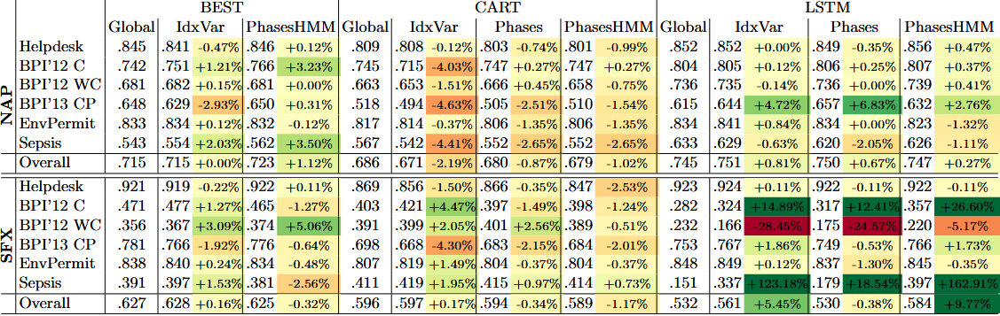

# Holdout results for PPM models

We performed model runs for different HHM-PPM model combinations (Phases, PhasesHMM) and the corresponding baselines (Global, IdxVar) for model pipelines tuned on the inner 5-fold cross-validation splits and eventually tested on a previously held out test set of 20\% of the original data per dataset.
Metrics reported are: Accuracy for Next Activity Prediction (NAP), Normalized Damerau-Levenshtein-Similarity for Activity Suffix Prediction (SFX).

|PPM Task| Dataset   |BEST Global|BEST IdxVar|Best PhasesHMM|CART Global|CART IdxVar|CART Phases|CART PhasesHMM|LSTM Global|LSTM IdxVar|LSTM Phases|LSTM PhasesHMM|
|---     |---        |---        |---        |---           |---        |---        |---        |---           |---        |---        |---        |---           |
| **NAP**| Helpdesk  | .845      | .841      | .846         | .809      | .808      | .803      | .801         | .852      | .852      | .849      | .856         |
|        | BPI'12 C  | .742      | .751      | .766         | .745      | .715      | .747      | .747         | .804      | .805      | .806      | .807         |
|        | BPI'12 WC | .681      | .682      | .681         | .663      | .653      | .666      | .658         | .736      | .735      | .736      | .739         |
|        | BPI'13 CP | .648      | .629      | .650         | .518      | .494      | .505      | .510         | .615      | .644      | .657      | .632         |
|        | EnvPermit | .833      | .834      | .832         | .817      | .814      | .806      | .806         | .834      | .841      | .834      | .823         |
|        | Sepsis    | .543      | .554      | .562         | .567      | .542      | .552      | .552         | .633      | .629      | .620      | .626         |
|        |           | .715      | .715      | .723         | .686      | .671      | .680      | .679         | .745      | .751      | .750      | .747         |
| **SFX**| Helpdesk  | .921      | .919      | .922         | .869      | .856      | .866      | .847         | .923      | .924      | .922      | .922         | 
|        | BPI'12 C  | .471      | .477      | .465         | .403      | .421      | .397      | .398         | .282      | .324      | .317      | .357         | 
|        | BPI'12 WC | .356      | .367      | .374         | .391      | .399      | .401      | .389         | .232      | .166      | .175      | .220         | 
|        | BPI'13 CP | .781      | .766      | .776         | .698      | .668      | .683      | .684         | .753      | .767      | .749      | .766         | 
|        | EnvPermit | .838      | .840      | .834         | .807      | .819      | .804      | .804         | .848      | .849      | .837      | .845         | 
|        | Sepsis    | .391      | .397      | .381         | .411      | .419      | .415      | .414         | .151      | .337      | .179      | .397         | 
|        | Overall   | .627      | .628      | .625         | .596      | .597      | .594      | .589         | .532      | .561      | .530      | .584         | 

Relative percentage changes with a color indicator for each model compared to the Global baseline are also visible in the rendered table below:

